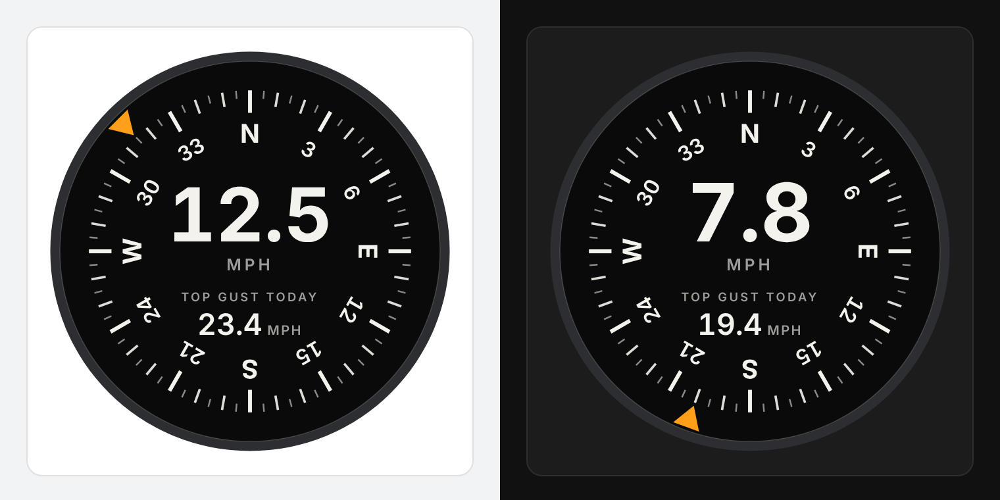

# Wind Compass Card

An aircraft-style compass for Home Assistant dashboards. An amber marker on the bezel shows where the wind is coming from, current wind speed sits large in the centre, and today's top gust sits smaller beneath it.



## Provided as is

This card is shared as is, without warranty or support. Issues are open so you can report problems, but there is no promise of a reply or a fix. Fork it freely.

## What it needs

Three sensors, which most weather stations already provide:

| Setting | Expects |
| --- | --- |
| Wind direction | Degrees from 0 to 360, or compass text such as `NW` |
| Wind speed | A number with a unit (mph, km/h, m/s or kn) |
| Top gust today | A number with a unit. Use your station's daily maximum gust sensor, or build one with a Statistics helper (maximum, over 24 hours) |

Units are read from each sensor, so the card shows whatever your sensors report.

## Install

### Home Assistant Marketplace (HACS)

Search for **Wind Compass Card** under **Settings > Marketplace** (or in HACS on Home Assistant 2026.10 and older), download it, then reload the browser.

### Manual

1. Download `wind-compass-card.js` from the latest release.
2. Copy it to `/config/www/wind-compass-card.js`.
3. Go to **Settings > Dashboards**, open the three-dot menu, choose **Resources**, and add `/local/wind-compass-card.js` as a **JavaScript module**. If Resources is missing, turn on Advanced mode in your user profile.
4. Reload the browser.

## Add the card

Edit a dashboard, choose **Add card**, and pick **Wind Compass**. The editor tries to find your wind sensors and lets you change them.

YAML equivalent:

```yaml
type: custom:wind-compass-card
direction_entity: sensor.wind_direction
speed_entity: sensor.wind_speed
gust_entity: sensor.wind_gust_max_today
name: Wind # optional
```

## Using it

- The marker turns the short way round when the wind shifts, and dims when the wind speed is 0.
- Tap the speed, the gust or the dial to open that sensor's history.
- In a sections dashboard the card defaults to half width and can be resized.

## Colours

The dial stays dark on light and dark themes, like an instrument. Override any colour from a theme or with card-mod:

| Variable | Default | Controls |
| --- | --- | --- |
| `--wind-compass-face` | `#0a0a0a` | Dial face |
| `--wind-compass-bezel` | `#2c2e32` | Outer ring |
| `--wind-compass-marks` | `#f3f2ec` | Ticks, letters and numbers |
| `--wind-compass-dim` | `#9c9d98` | Units and the gust label |
| `--wind-compass-pointer` | `#ff9f1a` | Direction marker |

## License

MIT. See [LICENSE](LICENSE).
